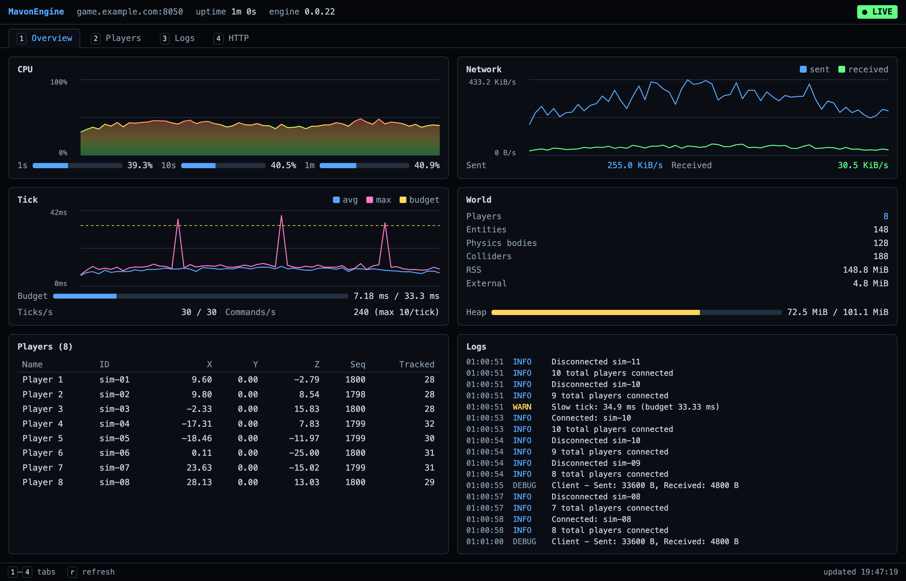

# @mavonengine/http-monitoring



A [MavonEngine](https://mavonengine.com) plugin that serves the game server dashboard in the browser. It has the same tabs and data as [`mavonengine dashboard`](https://github.com/MavonEngine/Core/tree/main/packages/cli#mavonengine-dashboard): Overview, Players, Logs and HTTP. It runs inside the game server and sits behind HTTP Basic auth, with users from an htpasswd file.

```sh
npx @mavonengine/cli install @mavonengine/http-monitoring
```

Then open `http://<your server>:8050/monitoring/`.

## Logging in

The dashboard logs in with the game server's admin token, the same one as every other admin route of the server, so it needs no secret of its own:

```sh
MAVONENGINE_ADMIN_TOKEN=… npm start
```

or `adminToken` in the server's options. In the browser's login prompt, enter the token as the password; the user name can be anything. Tools can send it as `Authorization: Bearer <token>` instead.

**An htpasswd file** adds a login per person next to that. Create it with Apache's `htpasswd`; bcrypt (`-B`) is the strongest hash it supports:

```sh
htpasswd -cB .htpasswd alice
htpasswd -B .htpasswd bob
```

```json
{
  "plugins": {
    "@mavonengine/http-monitoring": { "enabled": true, "options": { "htpasswd": ".htpasswd" } }
  }
}
```

The path is relative to the project root, the directory with `mavonengine.json`. `MAVONENGINE_MONITORING_HTPASSWD` works too. Keep the file out of git. Changes to it are picked up while the server runs: new users can log in, and removed users are logged out.

Supported hashes: bcrypt (`$2y$`, `$2b$`, `$2a$`), Apache MD5 (`$apr1$`, htpasswd's default) and SHA-1 (`{SHA}`). crypt(3) and plain-text lines are skipped with a warning.

`MAVONENGINE_MONITORING_USER` and `MAVONENGINE_MONITORING_PASSWORD`, the plugin's own single login, still work but are deprecated: use the admin token instead. The server logs a warning when they are set.

**No admin token and no htpasswd file**: in development the dashboard only answers requests from the server's own machine. With `NODE_ENV=production` it stays off, and the server logs why.

Basic auth sends the password with every request, readable to anyone in between unless the connection is encrypted. On a public server, put HTTPS in front of the game server, for example with a reverse proxy.

Successful logins are cached for 10 minutes, so bcrypt doesn't run on every poll. After 10 failed logins, an address is locked out for 5 minutes. Failed logins show up as warnings in the server log.

## Options

Set in `mavonengine.json` under `plugins["@mavonengine/http-monitoring"].options`:

| Option | Default | |
| --- | --- | --- |
| `path` | `/monitoring` | Where the dashboard is served. Can't be `/` |
| `htpasswd` | `$MAVONENGINE_MONITORING_HTPASSWD` | htpasswd file, relative to the project root |
| `realm` | `MavonEngine monitoring` | Shown in the browser's login prompt |
| `pollIntervalMs` | `1000` | How often the page fetches new data, at least 250 |

## Without mavonengine.json

```ts
import { createHttpMonitoring } from '@mavonengine/http-monitoring'

const server = new MyServer(logger, physicsWorld, {
  plugins: [createHttpMonitoring({ htpasswd: '/etc/mygame/monitoring.htpasswd' })],
})
```

## Endpoints

All of them are behind the login.

| Path | |
| --- | --- |
| `/monitoring/` | The dashboard |
| `/monitoring/api/metrics` | The server's metrics snapshot, as `GET /api/game/metrics` |
| `/monitoring/api/logs?after=<id>` | Log entries after `id`. 404 when `metrics.logBufferSize` is 0 |
| `/monitoring/api/requests?after=<id>` | HTTP requests after `id`. 404 when `metrics.requestLogSize` is 0 |

The page's own polling is left out of the HTTP tab, like the CLI dashboard's is. Every page is sent with `Cache-Control: no-store`, a strict Content-Security-Policy and `X-Frame-Options: DENY`. Player names, log lines and request paths are shown as text, never as HTML.

Keys: `1`–`4` switch tabs, `r` refreshes now, and on the Players tab the arrow keys (or `j`/`k`) select a player and `Esc` clears the selection.

Needs a `@mavonengine/core` release with engine plugins (0.0.22 or newer).
